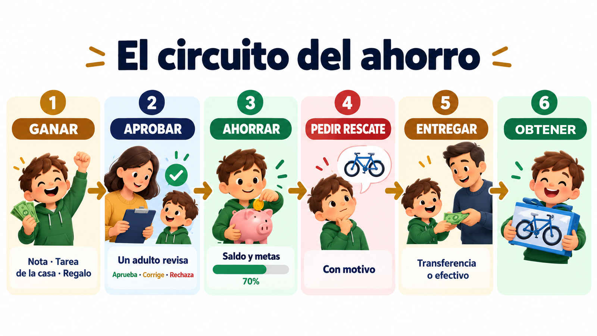
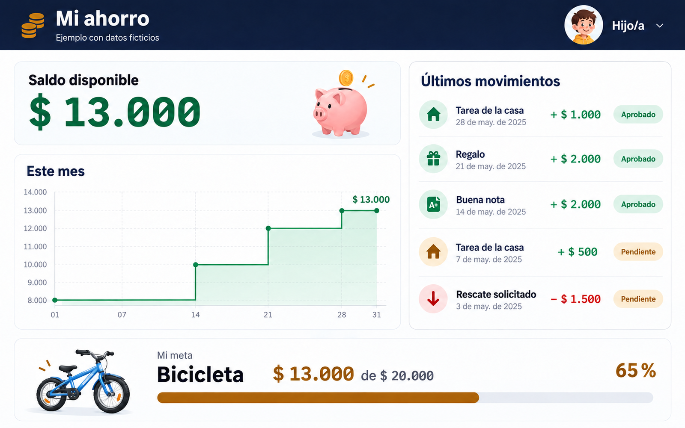
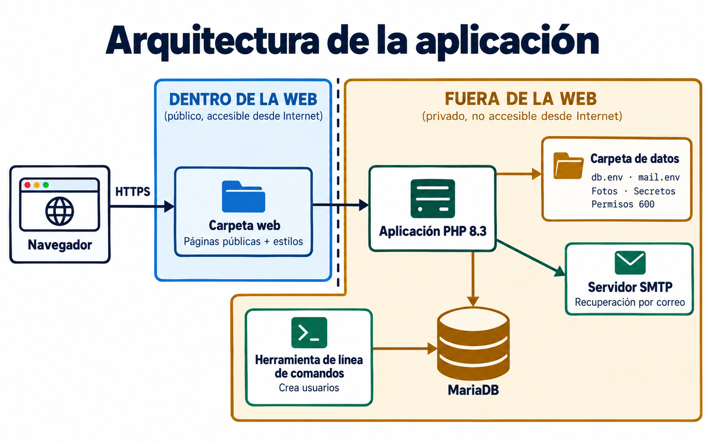
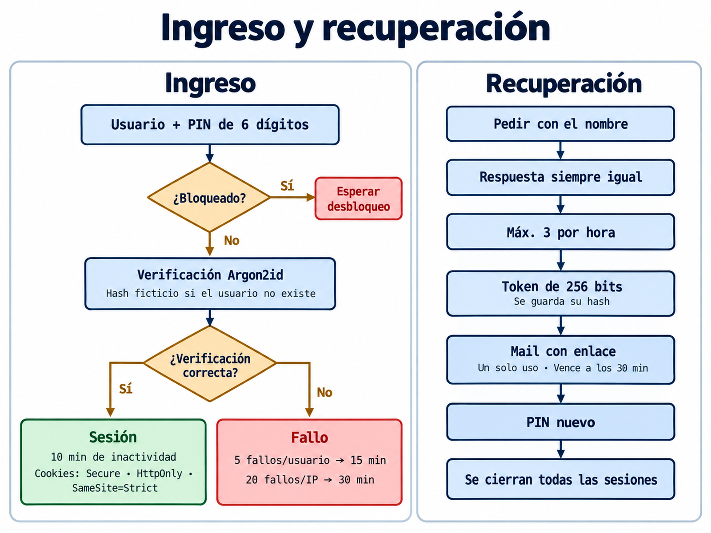

# Family Savings

**Un mini banco familiar para que los chicos aprendan a ahorrar: ellos ven su plata, sus logros y sus metas; los adultos aprueban y administran.**
Sitio web propio (PHP + MariaDB) con estética de plataforma de trading, pensado para que los chicos se vayan familiarizando con cómo se ven los brokers.

[English summary](README.en.md) · Autor: Mariano Araujo · Licencia MIT

## En un minuto

1. **Problema:** a los chicos se les da plata "por tandas" y no ven nada: no hay registro de qué lograron, cuánto juntaron ni para qué.
   Tampoco pueden tener una cuenta bancaria propia.
2. **Idea:** un libro de cuentas familiar que **simula un banco**. Los adultos son los administradores; cada hijo/a tiene su
   cuenta, ve su saldo, su historial y sus metas.
3. **Qué hace:** convierte los logros (notas, ayuda en la casa, estudio, regalos) en premios **visibles**, y completa el circuito:
   **ganar → ahorrar → pedir el rescate → obtener**.
4. **Qué no es:** no se conecta a ningún banco ni guarda datos bancarios. Es un registro informativo; el dinero real lo entregan los adultos.

## Cómo se ve

Tablero de un hijo/a (ejemplo con datos ficticios): saldo, gráfico del mes, movimientos con su estado y una meta con barra de avance.

## Arquitectura

El código de la aplicación, los datos y los secretos quedan **fuera** de la carpeta que publica el servidor web.

Ingreso y recuperación del PIN, en detalle en [`docs/login.md`](docs/login.md) y [`docs/recovery.md`](docs/recovery.md):

## Qué aprenden los chicos

- **Ahorrar con un objetivo:** metas con barra de avance ("llegaste" cuando se alcanza el monto).
- **Que el esfuerzo tiene recompensa visible:** cada nota o tarea queda anotada con su premio, no se pierde en una mano que da plata.
- **Estimular la ayuda en la casa y el estudio:** las tareas y las notas tienen un valor configurable por los adultos.
- **Pedir antes de gastar:** para usar el ahorro hay que pedir un rescate con un motivo; el monto queda reservado hasta que un adulto lo entrega.
- **Convivir con plataformas financieras:** tablero con saldo, gráfico del mes, lista de movimientos con importe y estado, tema claro u oscuro.

## Cómo trabajan los adultos

Los chicos cargan lo que lograron (con foto de la nota, si quieren) y **todo queda pendiente** hasta que un adulto lo revisa.
El adulto puede aprobarlo, **rechazarlo o corregirlo**; nada se borra: los errores se **anulan con un movimiento inverso** y
queda quién cargó, quién revisó y cuándo.

| Rol | Puede |
|---|---|
| **Hijo/a** | Ver su saldo e historial · cargar notas, tareas, regalos o ventas · armar metas · pedir rescates · anotar gastos · ver su Efectivo aparte · elegir avatar y tema |
| **Adulto (admin)** | Aprobar, rechazar o corregir lo cargado · entregar rescates (transferencia o efectivo) · anular movimientos · configurar premios por nota, tareas y mensualidad · aplicar deméritos o devoluciones · ver el registro de ingresos al sitio |

## Qué incluye

- [`src/app/`](src/app/) lógica (cuentas, notas, imágenes, avatares, sesiones, seguridad) y vistas.
- [`src/web/`](src/web/) páginas públicas, estilos (tipografías Inter y Noto Sans Mono servidas localmente) y gráfico SVG propio.
- [`src/sql/`](src/sql/) esquema de MariaDB y migraciones; la aplicación las aplica sola al abrir la base.
- [`src/herramientas/`](src/herramientas/) línea de comandos para crear usuarios y poner el PIN **sin eco** (`usuario.php`) y procesar fotos de notas.
- [`examples/`](examples/) plantillas de configuración sin datos reales.
- [`docs/`](docs/): [cómo funciona](docs/how-it-works.md), [ingreso](docs/login.md), [recuperación del PIN](docs/recovery.md), [alta de usuarios](docs/users.md), [seguridad](docs/security.md), [instalación](docs/install.md) y [límites](docs/limitations.md).

## Seguridad en una línea

PIN de 6 dígitos (se guarda sólo el hash Argon2id), bloqueo por tiempo y por IP, sesión que se cierra a los 10 minutos, token CSRF,
HTTPS, código y datos **fuera** de la carpeta web y recuperación del PIN por un link de un solo uso. Detalle en [`docs/security.md`](docs/security.md).

## Qué garantiza este repositorio y qué no

- **Sí:** que el código es el de un sitio que usa una familia real, sin sus datos, nombres ni credenciales, y que pasa `php -l` en PHP 8.3.
- **No:** que sea un producto listo para instalar con un clic, ni que sirva como servicio bancario. No hay pruebas automáticas en este
  repositorio ni capturas reales (los dibujos son ilustrativos). Ver [`docs/limitations.md`](docs/limitations.md).
