# Family Savings

**A family mini bank that teaches children to save: they see their money, their achievements and their goals; the adults approve and manage.**
A self-hosted website (PHP + MariaDB) styled like a trading platform, so children get familiar with how brokers look.

[Versión en español](README.es.md) · Author: Mariano Araujo · MIT License · The site's interface is in Spanish.

## In one minute

1. **Problem:** children get money "in batches" and see nothing: there is no record of what they achieved, how much they saved or what for.
   They cannot have a bank account of their own either.
2. **Idea:** a family ledger that **simulates a bank**. The adults are the administrators; each child has an
   account and sees their balance, history and goals.
3. **What it does:** it turns achievements (school grades, help at home, studying, gifts) into **visible** rewards, and closes the circuit:
   **earn → save → request a withdrawal → get it**.
4. **What it is not:** it does not connect to any bank or store banking data. It is an informational record; the adults hand over the real money.

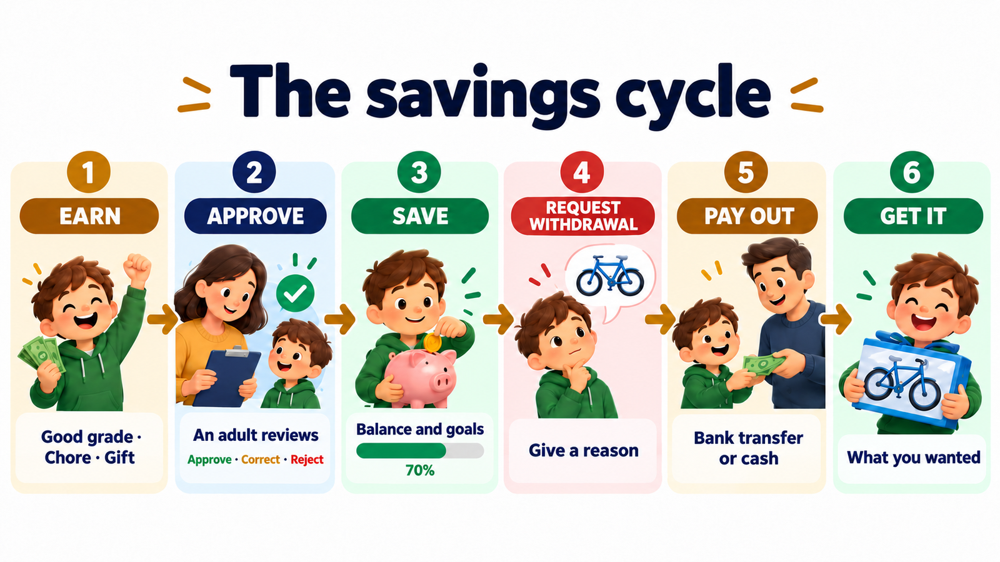

## What it looks like

Screenshots of the running site, with **fictional** users and entries (Ana, Beto and Tutor). **Click a thumbnail to see it full size.** Diagrams are in English; the screens show the site as it runs, in Spanish, and each one is described in its caption.

<table>
<tr><td align="center" valign="top"><a href="docs/screenshots/01-ingreso.png">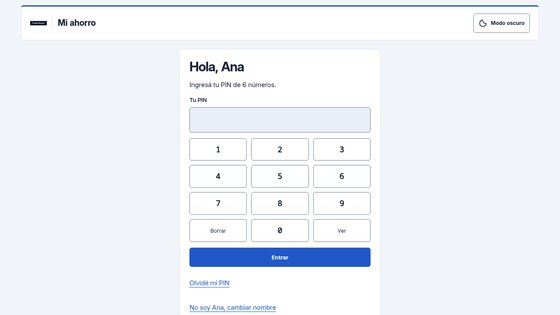</a> Login: name and 6-digit PIN</td><td align="center" valign="top"><a href="docs/screenshots/02-recuperacion.png">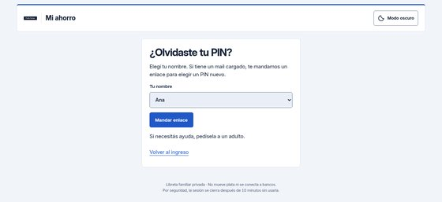</a> PIN recovery by email</td><td align="center" valign="top"><a href="docs/screenshots/03-tablero-hijo.png">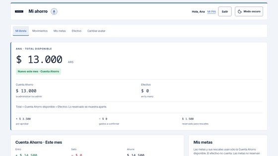</a> Child's dashboard: balance, chart and entries</td></tr>
<tr><td align="center" valign="top"><a href="docs/screenshots/04-cargar-logro.png">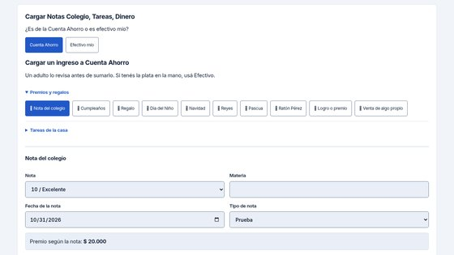</a> Adding a grade with its reward</td><td align="center" valign="top"><a href="docs/screenshots/05-metas-rescate.png">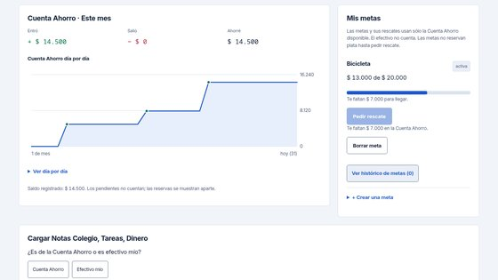</a> Goals with a progress bar and a withdrawal request</td><td align="center" valign="top"><a href="docs/screenshots/06-adulto-pendientes.png">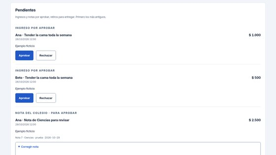</a> Adult: approve, reject or correct</td></tr>
<tr><td align="center" valign="top"><a href="docs/screenshots/07-adulto-resumen.png">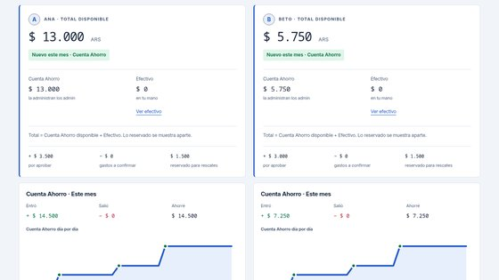</a> Adult: balance summary</td><td align="center" valign="top"><a href="docs/screenshots/08-adulto-accesos.png">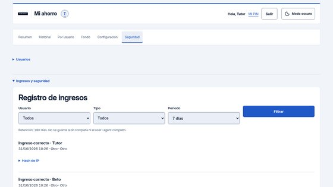</a> Adult: login log</td><td align="center" valign="top"><a href="docs/screenshots/09-tablero-hijo-oscuro.png">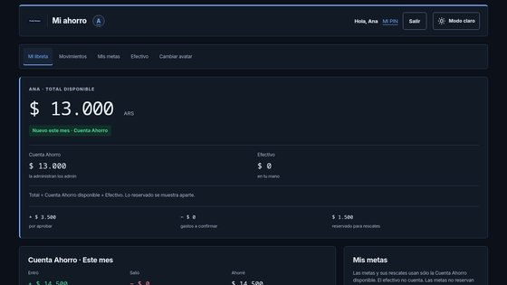</a> Dark theme</td></tr>
<tr><td align="center" valign="top"><a href="docs/screenshots/10-tablero-hijo-movil.png">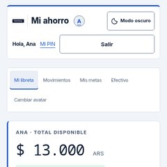</a> On a phone</td></tr>
</table>

Illustrative drawing of a child's dashboard:

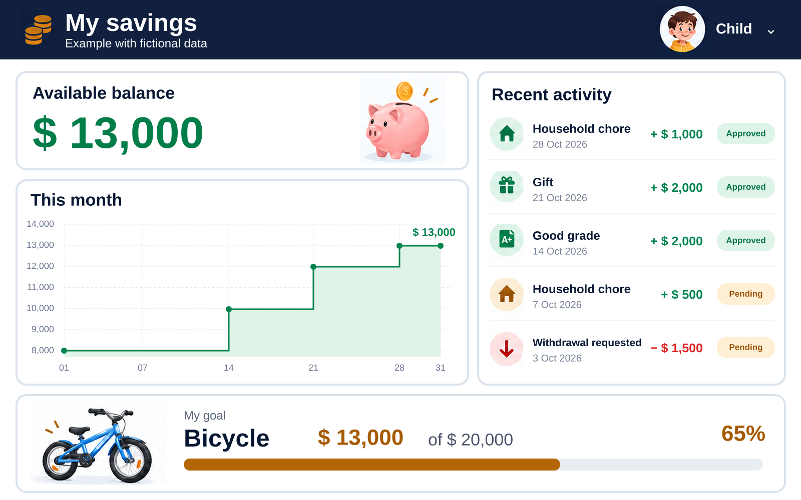

## Architecture

The application code, the data and the secrets stay **outside** the folder the web server publishes.

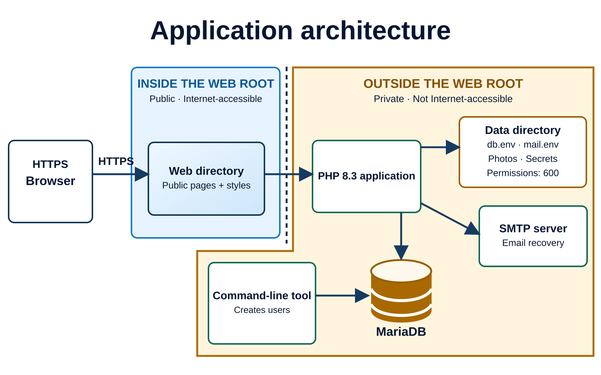

Login and PIN recovery, in detail in [`docs/login.md`](docs/login.md) and [`docs/recovery.md`](docs/recovery.md) (Spanish):

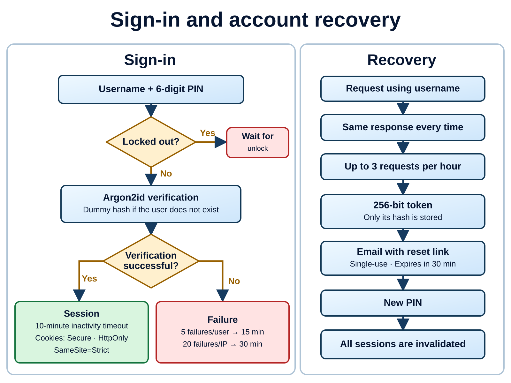

## What children learn

- **Saving with a goal:** goals with a progress bar ("you made it" when the amount is reached).
- **That effort has a visible reward:** each grade or chore is recorded with its reward instead of disappearing into a hand that gives money.
- **Encouraging help at home and studying:** chores and grades have a value the adults can configure.
- **Asking before spending:** to use their savings they request a withdrawal with a reason; the amount is reserved until an adult hands it over.
- **Getting used to financial platforms:** a dashboard with balance, a monthly chart, a list of entries with amount and status, light or dark theme.

## How the adults work

Children enter what they achieved (with a photo of the grade, if they want) and **everything stays pending** until an adult reviews it.
The adult can approve it, **reject it or correct it**; nothing is deleted: mistakes are **cancelled with a reversing entry** and
the record keeps who entered it, who reviewed it and when.

| Role | Can |
|---|---|
| **Child** | See their balance and history · enter grades, chores, gifts or sales · create goals · request withdrawals · record expenses · see their Cash separately · choose an avatar and a theme |
| **Adult (admin)** | Approve, reject or correct entries · hand over withdrawals (transfer or cash) · cancel entries · configure rewards per grade, chores and allowance · apply demerits or refunds · see the site's login log |

## What it includes

- [`src/app/`](src/app/) logic (accounts, grades, images, avatars, sessions, security) and views.
- [`src/web/`](src/web/) public pages, styles (Inter and Noto Sans Mono fonts served locally) and a custom SVG chart.
- [`src/sql/`](src/sql/) MariaDB schema and migrations; the application applies them by itself when it opens the database.
- [`src/herramientas/`](src/herramientas/) command line to create users and set the PIN **without echo** (`usuario.php`) and to process photos of grades.
- [`examples/`](examples/) configuration templates without real data.
- [`docs/`](docs/) in English: [how it works](docs/how-it-works.en.md) and [installation](docs/install.en.md). In Spanish: [login](docs/login.md), [PIN recovery](docs/recovery.md), [creating users](docs/users.md), [security](docs/security.md) and [limits](docs/limitations.md).

## Security in one line

6-digit PIN (only the Argon2id hash is stored), lockout by time and by IP, session closed after 10 minutes, CSRF token,
HTTPS, code and data **outside** the web folder and PIN recovery through a one-time link. Details in [`docs/security.md`](docs/security.md) (Spanish).

## What this repository guarantees and what it does not

- **Yes:** the code is the one of a site used by a real family, without its data, names or credentials, and it passes `php -l` on PHP 8.3.
- **No:** that it is a one-click product, or that it works as a banking service. Apart from a check that keeps the English and Spanish
  documents in sync, there are no automated tests in this repository beyond the visual checks shown in these screenshots. See [`docs/limitations.md`](docs/limitations.md) (Spanish).
