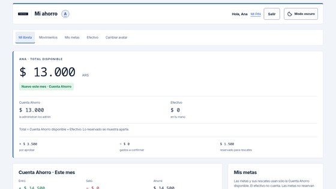
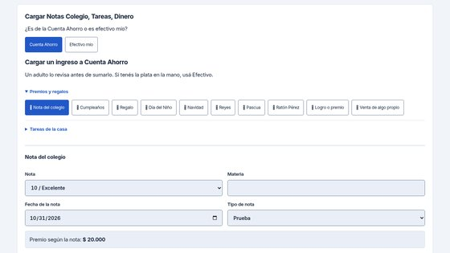
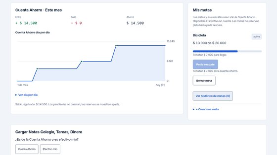
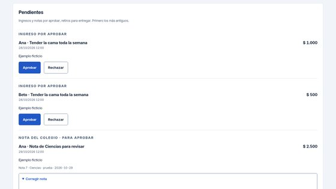

# How it works

[Versión en español](how-it-works.md)

## The circuit

1. **Earn:** the child enters an income: a school grade (with an optional photo), a chore at home, a gift, the sale of something of their own, a birthday or
   a special date. The suggested amounts (per grade, per chore) are set by an adult.
2. **Approve:** the income stays **pending** under "Para aprobar" ("To approve"). An adult approves, rejects or corrects it. Only then is it added to the balance.
3. **Save:** the balance is shown in large type with its history and a monthly chart. The child can create **goals** with a progress bar.
4. **Withdraw:** to use the money they request a **withdrawal** with a reason (also from a goal). The amount is reserved.
5. **Hand over:** an adult approves it and marks it as handed over, by transfer or in cash. The **Cash** the child has on hand is tracked separately.

Screenshots (click to enlarge):    

## Rewards per grade (example values)

The `premios` (rewards) table defines how much each grade pays. The schema ships with these initial values, which are edited from Settings:

| Grade | Reward |
|---|---|
| 10 | 20,000 |
| 9 | 10,000 |
| 8 | 5,000 |
| 7 | 2,500 |
| below 7 | 0 (still recorded) |

## Rules that protect the record

- **Nothing is deleted.** A mistake is cancelled with a reversing entry; the original is kept, along with who entered it, who reviewed it and when.
- **Always one child per entry:** each entry belongs to a single child (there is no "both").
- **Devaluation and Fund:** an adult can apply a devaluation (with a reason) that deducts free balance and sends it to a shared fund,
  refund a demerit from that fund, or apply a demerit from the tutor. Cancelling an entry also reverts the fund.
- **Allowance and optional interest** to encourage saving (0 = off).
- **Categories** the adults can turn off.

## Look and feel

"Terminal" look: a dashboard with a *watchlist*-style list of entries, amounts in green/red, monospaced numbers
and a **light theme by default**, with a dark mode saved in each user's profile.
