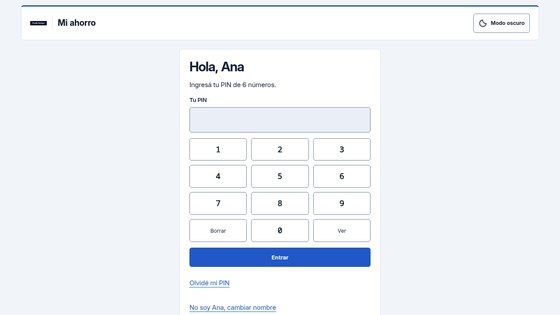
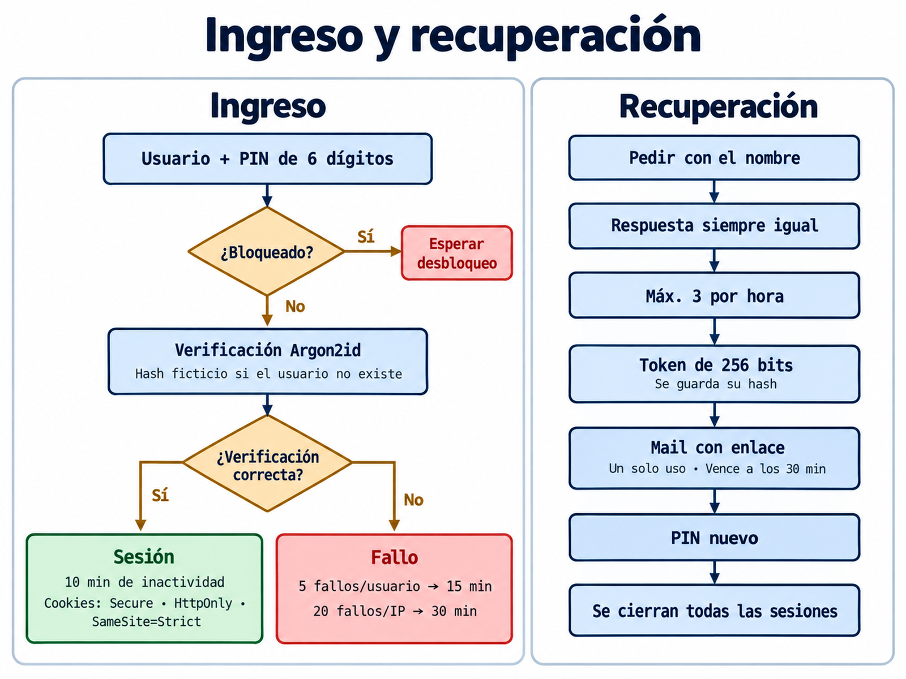

# Ingreso (login)

## Qué se pide
**Nombre de usuario + PIN de 6 dígitos.** No hay contraseñas largas: es un sitio pensado para chicos, con un único factor y defensas
alrededor para compensarlo (ver [límites](limitations.md)).

## Reglas del PIN (`pin_valido`)
- Exactamente 6 números.
- No puede ser un dígito repetido (`111111`).
- No puede ser un patrón repetido de 2 o 3 dígitos (`121212`, `123123`).
- No puede ser una secuencia ascendente o descendente (`123456`, `654321`, `901234`).

El PIN se guarda sólo como hash **Argon2id** (`password_hash`); nunca se registra ni se muestra.

## Pasos de una autenticación
1. Se borran registros viejos: accesos de más de 180 días y sesiones vencidas.
2. Con el hash de la IP se abre (o se crea) su fila de límites y se bloquean las filas del usuario y de la IP (`FOR UPDATE`) para evitar carreras.
3. Si el usuario no existe se verifica igual contra un **hash ficticio** persistente: el tiempo de respuesta no revela si el nombre existe.
4. Si la IP o el usuario están bloqueados: se registra el evento `bloqueo` y se rechaza.
5. Si el PIN falla (o el usuario está inactivo): se suma un fallo a la IP y al usuario dentro de una **ventana de 15 minutos** y se registra `fallo`.
6. Si es correcto: se ponen en cero los fallos, se registra `ingreso`, se crea una sesión nueva y se rotan las cookies.

## Umbrales
| Control | Valor |
|---|---|
| Fallos por usuario | 5 en 15 min → bloqueo del usuario por 15 min |
| Fallos por IP | 20 en 15 min → bloqueo de la IP por 30 min |
| Inactividad de la sesión | 10 min |
| Retención del registro de accesos | 180 días |

Un adulto puede **desbloquear** un usuario o una IP desde la línea de comandos (`usuario.php desbloquear`).

## Sesión y cookies
- Token de 256 bits aleatorios; en la base sólo se guarda su **SHA-256**.
- Cookies `__Secure-*`: `Secure`, `HttpOnly`, `SameSite=Strict`, con ruta propia del subsitio.
- Cada ingreso o salida **rota** la cookie CSRF. El token CSRF es un HMAC de esa cookie con una sal secreta, no ligado a la sesión.
- Cambiar el PIN **cierra todas las sesiones** del usuario.
- La IP no se guarda en claro: se guarda un **HMAC-SHA256** con sal secreta; se tratan igual las IPv4 mapeadas en IPv6 y no se confía en `X-Forwarded-For`.

## Verificación de origen
Todo POST pasa por `origen_permitido`: rechaza `Origin` ajeno, `Sec-Fetch-Site: cross-site` y un `Referer` fuera del subsitio. El CSRF sigue siendo obligatorio.

## Registro de accesos
Cada evento (`ingreso`, `salida`, `fallo`, `bloqueo`, `recuperacion_pedida`, `recuperacion_usada`) guarda usuario, fecha, hash de IP y
dispositivo aproximado (navegador · sistema). Los adultos lo ven en su tablero.

## PIN provisorio
Si un adulto pone un PIN con `usuario.php pin`, la cuenta queda con `debe_cambiar=1`: el usuario sólo puede **cambiar su PIN o salir** hasta elegir uno propio.

Capturas (clic para agrandar): 

