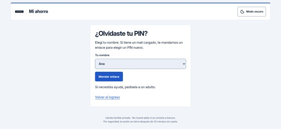
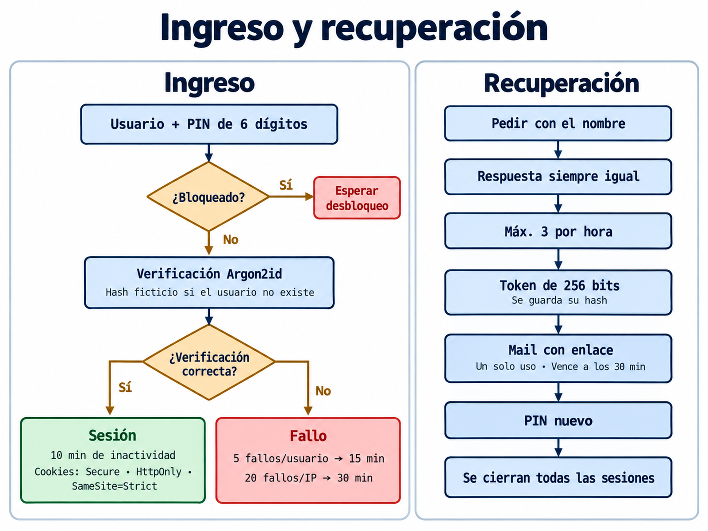

# Recuperación del PIN

Todos los usuarios, adultos incluidos, pueden recuperar su PIN por mail si tienen uno cargado.

## Flujo
1. **Pedido:** la persona escribe su nombre en la página de recuperación. La respuesta es **siempre la misma**, exista o no el usuario, tenga o no mail
   (así no se pueden averiguar nombres). En pantalla sólo se puede mostrar el mail enmascarado (`a•••@dominio`).
2. **Tope:** máximo **3 pedidos por hora y por usuario**; cada pedido deja un evento `recuperacion_pedida`.
3. **Token:** 256 bits aleatorios; en la base sólo se guarda su **SHA-256**, con fecha de creación y de vencimiento (**30 minutos**).
4. **Mail:** se envía por SMTP propio (465 con TLS o 587 con STARTTLS, con verificación de certificado y del nombre del servidor), con un enlace de un solo uso.
   Si el envío falla, el token se marca como usado para que no quede un enlace vivo.
5. **Canje:** el enlace abre un formulario para elegir un PIN nuevo (mismas reglas que el ingreso). Se verifica dentro de una transacción que el token exista,
   no esté usado y no haya vencido, y que el usuario siga activo.
6. **Efecto:** se guarda el hash del PIN nuevo, se **cierran todas las sesiones**, se ponen en cero los bloqueos, se invalidan los demás enlaces pendientes y se registra `recuperacion_usada`.

## Detalles de seguridad
- El enlace usa `GET ?t=<token>`; la sesión en curso no es necesaria (la cookie `SameSite=Strict` no viaja al abrir un enlace desde un mail, por eso el CSRF no depende de la sesión).
- Los mensajes de error son genéricos: *"El enlace venció o ya fue usado"*.
- Cabeceras de mail saneadas (sin saltos de línea) y puntos iniciales escapados en el cuerpo SMTP.
- Si la persona no tiene mail, un adulto le pone un PIN provisorio desde la línea de comandos.

Capturas (clic para agrandar): 

